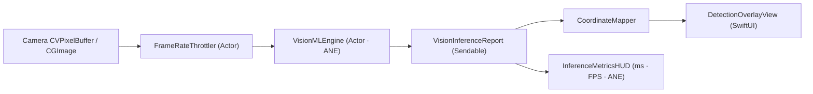

<div align="center">

#  SwiftVisionML

**Zero-dependency Swift 6 toolkit for sub-12ms on-device Core ML & Vision inference with drop-in SwiftUI overlays and live Apple Neural Engine (ANE) telemetry.**

[](https://swift.org)
[](https://github.com/Vishal-iOS-Labs/SwiftVisionML/actions/workflows/swift.yml)
[](https://developer.apple.com)
[](https://swift.org/package-manager/)
[](LICENSE)

</div>

---

## Why SwiftVisionML?

Integrating **Core ML + Apple Vision** into a modern SwiftUI camera app usually requires repeating the same brittle boilerplate every single project:
- Wrapping `VNCoreMLRequest` safely for **Swift 6 strict concurrency** (`actor` + `Sendable`)
- Converting Vision's **bottom-left normalized coordinates** into SwiftUI's **top-left screen points** (with `.aspectFill` cropping, `.aspectFit` letterboxing, and front-camera mirroring!)
- Throttling camera frames cleanly so Core ML doesn't starve 120 FPS ProMotion UI rendering
- Profiling real on-device inference latency in milliseconds (`ContinuousClock`)

**SwiftVisionML** eliminates all of that with a clean, zero-dependency, actor-isolated Swift Package.

---

## ✨ Key Features

- **⚡ Swift 6 Actor-Isolated Engine (`VisionMLEngine`)**: Thread-safe `async/throws` image classification & object detection for both `CGImage` and live `CVPixelBuffer` streams.
- **📐 Exact Vision ↔ SwiftUI Geometry (`CoordinateMapper`)**: Handles Y-axis inversion, `.aspectFill` / `.aspectFit` scaling, and front-camera horizontal mirroring out of the box.
- **🎛️ Thermal-Safe Frame Throttling (`FrameRateThrottler`)**: Monotonic `ContinuousClock` actor that caps camera inference FPS dynamically (30 / 60 / 120 FPS).
- **🎨 Drop-In SwiftUI Overlays (`DetectionOverlayView` & `InferenceMetricsHUD`)**: Spring-animated bounding boxes with confidence pills plus a sleek glassmorphic latency/FPS/ANE HUD.
- **🧠 Explicit Compute Targeting (`ComputeTarget`)**: Cleanly choose `.neuralEnginePreferred`, `.cpuAndNeuralEngine`, `.cpuAndGPU`, or `.cpuOnly`.

---

## 🏗️ Architecture



---

## 📦 Installation (Swift Package Manager)

### Xcode
1. Go to **File → Add Package Dependencies…**
2. Enter the repository URL:
   ```
   https://github.com/Vishal-iOS-Labs/SwiftVisionML.git
   ```
3. Add `SwiftVisionML` to your app target.

### `Package.swift`
```swift
dependencies: [
    .package(url: "https://github.com/Vishal-iOS-Labs/SwiftVisionML.git", from: "1.0.0")
]
```

---

## 🚀 Quick Start

### 1. Run On-Device Core ML Inference in 5 Lines
```swift
import SwiftVisionML

let engine = try VisionMLEngine(
    compiledModelURL: modelURL,
    computeTarget: .neuralEnginePreferred
)

let report = try await engine.detect(
    pixelBuffer: cameraPixelBuffer,
    minimumConfidence: 0.35
)

print("Detected \(report.output.count) objects in \(report.metrics.formattedLatency)")
```

### 2. Drop Into SwiftUI With Live Bounding Boxes & ANE Telemetry HUD
```swift
import SwiftUI
import SwiftVisionML

struct LiveScannerView: View {
    @State private var detections: [VisionDetection] = []
    @State private var metrics: InferenceMetrics?

    var body: some View {
        ZStack(alignment: .topTrailing) {
            CameraPreviewView()

            DetectionOverlayView(
                detections: detections,
                contentSize: CGSize(width: 1080, height: 1920),
                contentMode: .aspectFill,
                accentColor: .cyan
            )

            if let metrics {
                InferenceMetricsHUD(metrics: metrics)
                    .padding()
            }
        }
    }
}
```

### 3. Throttle Live Camera Streams Cleanly
```swift
let throttler = FrameRateThrottler(targetFPS: 30)

func didCaptureFrame(_ buffer: CVPixelBuffer) {
    Task {
        guard await throttler.shouldProcessNextFrame() else { return }
        let report = try await engine.classify(pixelBuffer: buffer, topK: 3)
        // Dispatch Sendable report cleanly back to @MainActor UI
    }
}
```

---

## 🧪 Running Tests

```bash
swift test
```

All coordinate geometry, front-camera mirroring, letterboxing, frame throttling, and telemetry calculations are covered by Swift Testing unit tests.

---

## 🤝 Contributing

Contributions, issues, and feature requests are welcome! Feel free to open a Pull Request or start a discussion.

If **SwiftVisionML** saves you time building Core ML + SwiftUI apps, consider giving it a ⭐!

---

## 👤 Author

**Vishal Rao M** — Native iOS & On-Device AI Architect  
[GitHub](https://github.com/vishal-rao28) · [Live Portfolio](https://vishal-rao28.github.io/Vishal-s-portfolio/) · [LinkedIn](https://www.linkedin.com/in/vishal-rao-173a232b9)
